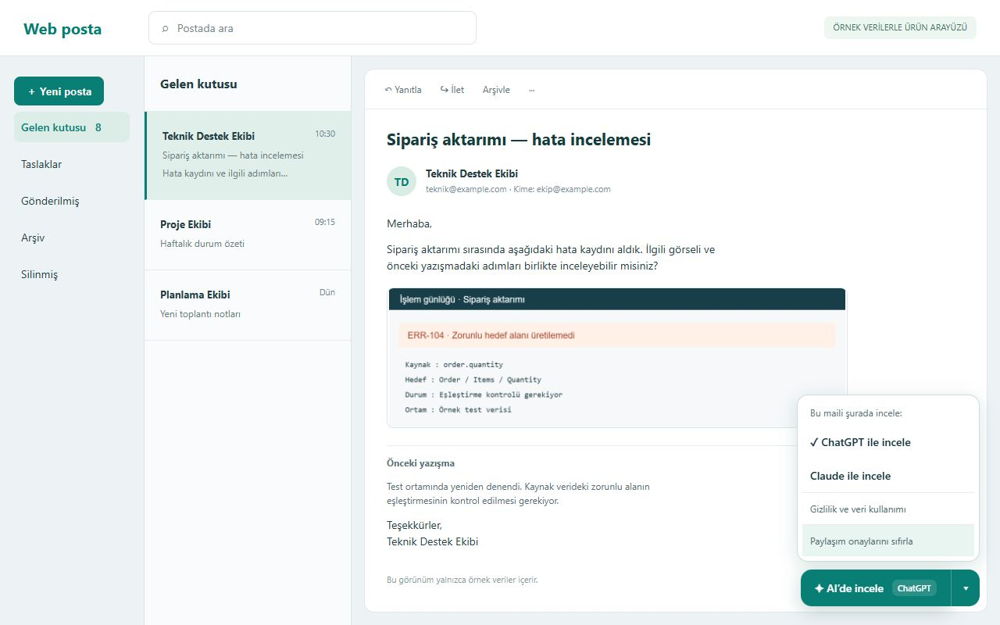
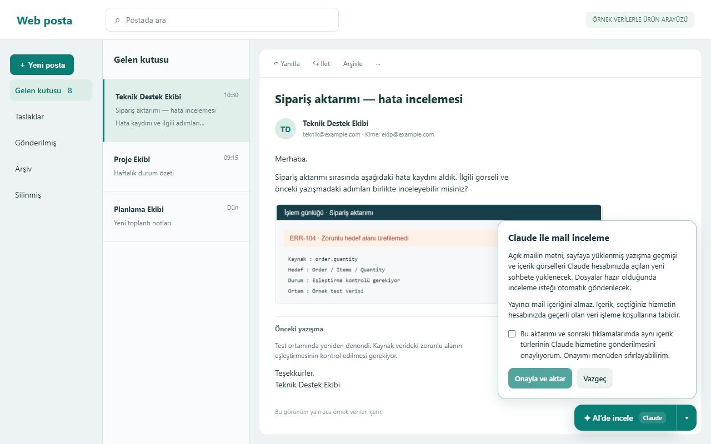

# AI’de İncele — Outlook için

Outlook Web’de açtığınız e-postayı, yüklenmiş yazışma geçmişi ve içerik görselleriyle birlikte **ChatGPT veya Claude’da yeni bir sohbete aktarın**.

AI’de İncele is a Chrome extension that transfers the currently open Outlook Web email and its original inline content images to a new ChatGPT or Claude conversation. The interface and default review prompt are in Turkish.

**Sürüm: 0.4.0 · Chrome Web Store yayını henüz yapılmadı.** Bu sürümün yerel kontrolleri tamamlandı; yüklenmiş uzantıyla son canlı Chrome testi bekliyor. Ayrıntılar: [doğrulama durumu](docs/VALIDATION.md).

## İndir ve kur

1. [Chrome uzantısı ZIP dosyasını indir](https://github.com/haliltalhaertan/ai-incele/raw/refs/heads/main/downloads/ai-incele-chrome-v0.4.0.zip) ve ayrı bir klasöre çıkar.
2. Chrome’da `chrome://extensions` sayfasını açıp **Geliştirici modu** seçeneğini etkinleştir.
3. **Paketlenmemiş öğe yükle** düğmesiyle ZIP’ten çıkan, `manifest.json` içeren klasörü seç.
4. Outlook Web sekmesini yenile. Daha eski AI’de İncele sürümü yüklüyse aynı anda iki kopyanın çalışmaması için önce onu devre dışı bırak.

Kaynak depoyu ZIP olarak indirdiysen üçüncü adımda bu depodaki `extension/` klasörünü seç. Chrome 120 veya üstü gerekir. Paket bütünlük özeti: [SHA256SUMS.txt](downloads/SHA256SUMS.txt).

## Kullanım

1. Outlook Web ve seçtiğin ChatGPT veya Claude hesabında oturum aç.
2. İncelemek istediğin maili aç; istediğin alıntı geçmişi ve görsellerin tamamen yüklendiğinden emin ol.
3. Sağ alttaki **AI’de incele** düğmesinin yanındaki oktan hizmeti seç.
4. O hizmeti ilk kez kullanırken paylaşım açıklamasını okuyup onayla.
5. Yeni sohbete mail metni ve ayrı görsel dosyaları yüklenir. Dosyalar hazır olduğunda Türkçe inceleme isteği otomatik gönderilir.

Son hizmet seçimi hatırlanır. Sonraki maillerde ana düğmeyle tek tıkla aktarım başlatılır. Menüdeki **Paylaşım onaylarını sıfırla** seçeneği onayları ve bekleyen yerel paketleri temizler.



## Özellikler

- ChatGPT ve Claude arasında seçim; her hizmet için ayrı paylaşım onayı.
- Açık mail metni ve sayfaya yüklenmiş alıntı geçmişi.
- İçerik görsellerini, Outlook’un yüklediği dosya baytlarını koruyarak ayrı PNG, JPEG, GIF veya WebP dosyaları halinde aktarma.
- Logo, imza bandı, imza QR kodu ve izleme pikseli filtresi.
- Görseller için boyut ve SHA-256 bütünlük kontrolü; aynı dosyaları tekilleştirme.
- Yükleme, dosya kotası veya taslak kontrolü başarısız olduğunda otomatik gönderimi durdurma.

Görseller ekran görüntüsüne veya kolaja dönüştürülmez, yeniden boyutlandırılmaz. Outlook yalnızca küçük bir kaynak dosyası yüklediyse bu sürüm o dosyayı korur; erişilemeyen daha yüksek çözünürlüklü bir kaynağı üretemez. Logo/imza filtresi sezgiseldir; her mail düzeninde kusursuz ayırım garantisi yoktur.

## Kapsam ve sınırlar

- Desteklenen Outlook adresleri: `outlook.cloud.microsoft`, `outlook.office.com`, `outlook.office365.com`.
- Hedefler: `chatgpt.com` ve `claude.ai`.
- Ayrı dosya ekleri (PDF, Excel, ZIP vb.), kapalı diğer iletiler ve CSS arka plan görselleri bu sürümde alınmaz.
- En fazla 19 içerik görseli ve 1 metin dosyası; görsel başına 20 MB, kodlanmış paket için toplam 28 MB sınırı.
- İlgili AI hizmetinin hesap, model ve dosya yükleme kotaları ayrıca geçerlidir. Hizmet arayüzleri değiştiğinde uyarlama gerekebilir.
- API anahtarı veya Microsoft hesabı için ayrı OAuth izni istemez. Kullanıcı kendi web hesaplarını kullanır.
- Bu sürümde ücretlendirme veya abonelik sistemi bulunmaz.

## Gizlilik

Mail içeriği yalnızca kullanıcının seçtiği AI hizmetine aktarılır. Yayıncının mail alan bir sunucusu, reklam veya analitik hizmeti yoktur. Bekleyen paket cihazdaki uzantı alanında AES-256-GCM ile şifrelenir; anahtar yalnızca Chrome oturum belleğinde tutulur. Paketler 15 dakika geçerlidir. Seçilen AI hizmetinin kendi veri işleme koşulları geçerlidir.

[Gizlilik politikasını oku](https://haliltalhaertan.github.io/ai-incele/privacy.html) · [Kısa veri akışı açıklaması](PRIVACY.md)



## Geliştirme ve kontroller

Üretim uzantısının derleme adımı veya çalışma zamanı npm bağımlılığı yoktur. Manifest V3 kaynakları `extension/` altındadır.

Node.js 18+ ile kaynak/paket kontrollerini çalıştır:

```sh
node scripts/check.mjs
```

Mevcut 32 arka plan kontrolünü tarayıcıda çalıştırmak için depo kökünü yerel HTTP sunucusuyla aç ve `/tests/background/` sayfasına git. Örneğin Python kuruluysa:

```sh
python -m http.server 8000 --bind 127.0.0.1
```

Sonra `http://127.0.0.1:8000/tests/background/` adresini aç. Testler gerçek IndexedDB ve WebCrypto kullanır; Chrome uzantı API’leri taklit edilir. Gerçek posta kutusuna veya AI hizmetlerine bağlanmaz. Bu kontroller, yüklenmiş uzantının canlı uçtan uca testi yerine geçmez.

## Destek

[GitHub Issues](https://github.com/haliltalhaertan/ai-incele/issues) · [haliltalhaertan@gmail.com](mailto:haliltalhaertan@gmail.com)

Hata bildirirken gerçek mail içeriği, kişisel bilgiler veya oturum bilgileri paylaşma; mümkünse örnek veri kullan.

AI’de İncele bağımsız bir uzantıdır. Microsoft, OpenAI veya Anthropic’in resmî ürünü değildir ve bu kuruluşlarla bağlantılı değildir.
