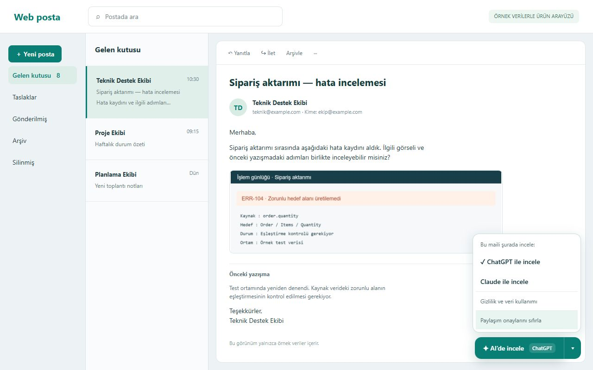
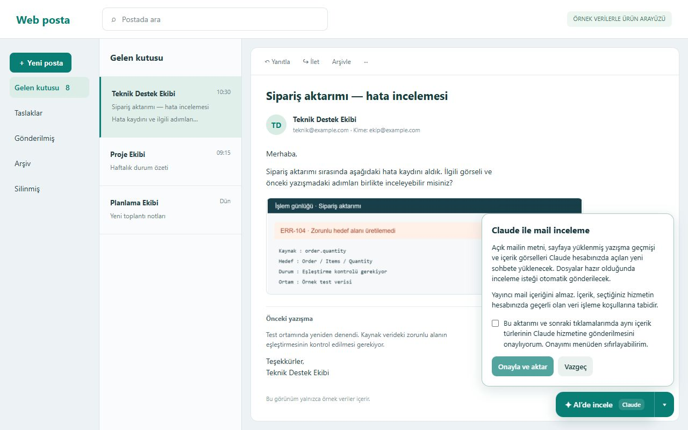

<a name="aide-i̇ncele--outlook-için"></a>
# AI’de İncele for Outlook

Send the email you have open in Outlook Web, along with its loaded conversation history and inline images, to **a new chat in ChatGPT or Claude**.

AI’de İncele is a Chrome extension that preserves the original inline image files during transfer. The interface and default review prompt are in Turkish.

**Version 0.4.0 · Not yet published in the Chrome Web Store.** Local checks are complete. A final live Chrome test with the installed extension is pending. See the [validation status](docs/VALIDATION.md) for details.

<a name="indir-ve-kur"></a>
## Download and Install

1. [Download the Chrome extension ZIP](https://github.com/haliltalhaertan/ai-incele/raw/refs/heads/main/downloads/ai-incele-chrome-v0.4.0.zip) and extract it to a separate folder.
2. Open `chrome://extensions` in Chrome and enable **Developer mode**.
3. Click **Load unpacked** and select the extracted folder containing `manifest.json`.
4. Refresh the Outlook Web tab. If an older version of AI’de İncele is installed, disable it first so two copies don't run at the same time.

If you downloaded the source repository as a ZIP instead, select this repository's `extension/` folder in step 3. Chrome 120 or later is required. To verify the package, see [SHA256SUMS.txt](downloads/SHA256SUMS.txt).

<a name="kullanım"></a>
## Usage

1. Sign in to Outlook Web and to the ChatGPT or Claude account you want to use.
2. Open the email you want to review. Make sure the quoted history and images you want are fully loaded.
3. Choose a service using the arrow next to the **AI’de incele** (“Review with AI”) button at the bottom right.
4. The first time you use that service, read and confirm the sharing notice.
5. The email text and separate image files are attached to a new chat. Once the files are ready, the extension automatically submits the Turkish review prompt.

The extension remembers the last service you selected. For subsequent emails, click the main button once to start transferring. The menu option **Paylaşım onaylarını sıfırla** (“Reset sharing approvals”) clears sharing approvals and pending local packages.



<a name="özellikler"></a>
## Features

- Choose between ChatGPT and Claude, with separate sharing approval for each service.
- Transfer the open email text and any quoted history loaded on the page.
- Transfer inline content images as separate PNG, JPEG, GIF, or WebP files, preserving the bytes loaded by Outlook.
- Filter logos, signature banners, signature QR codes, and tracking pixels.
- Check image size and SHA-256 integrity and remove duplicate files.
- Stop automatic submission if an upload, file quota, or draft check fails.

The extension does not convert images into screenshots or collages or resize them. If Outlook loaded only a small source file, this version preserves that file; it cannot recover a higher-resolution source it cannot access. Logo and signature filtering is heuristic and may not work perfectly for every email layout.

<a name="kapsam-ve-sınırlar"></a>
## Scope and Limits

- Supported Outlook domains: `outlook.cloud.microsoft`, `outlook.office.com`, and `outlook.office365.com`.
- Destinations: `chatgpt.com` and `claude.ai`.
- This version does not collect separate file attachments (PDF, Excel, ZIP, etc.), other messages that aren't open, or CSS background images.
- Up to 19 content images and 1 text file. The limit is 20 MB per image and 28 MB for the encoded package in total.
- The selected AI service's account, model, and file-upload limits also apply. Changes to service interfaces may require updates.
- No API key or separate Microsoft account OAuth permission is required. Users sign in to their own web accounts.
- This version does not have a billing or subscription system.

<a name="gizlilik"></a>
## Privacy

Email content goes only to the AI service the user selects. The publisher does not operate a server that receives email content or use advertising or analytics services. Pending packages are encrypted in the extension's local storage with AES-256-GCM; the key is held only in Chrome session memory. Packages expire after 15 minutes. The selected AI service's own data processing terms apply.

[Read the privacy policy](https://haliltalhaertan.github.io/ai-incele/privacy.html) · [Data flow overview](PRIVACY.md)



<a name="geliştirme-ve-kontroller"></a>
## Development and Checks

The production extension requires no build step or runtime npm dependencies. The Manifest V3 source files are under `extension/`.

Run the source and package checks with Node.js 18+:

```sh
node scripts/check.mjs
```

To run the 32 existing background checks in a browser, serve the repository root over local HTTP and open `/tests/background/`. For example, if Python is installed:

```sh
python -m http.server 8000 --bind 127.0.0.1
```

Then open `http://127.0.0.1:8000/tests/background/`. The tests use real IndexedDB and WebCrypto and mock the Chrome extension APIs. They do not connect to a real mailbox or AI services. These checks do not replace live end-to-end testing of the installed extension.

<a name="destek"></a>
## Support

[GitHub Issues](https://github.com/haliltalhaertan/ai-incele/issues) · [haliltalhaertan@gmail.com](mailto:haliltalhaertan@gmail.com)

When reporting a bug, do not share real email content, personal information, or session credentials. Use sample data if possible.

AI’de İncele is an independent extension. It is not an official Microsoft, OpenAI, or Anthropic product and is not affiliated with those organizations.
